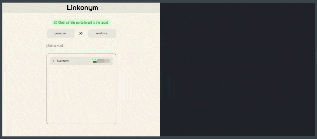

# Linkonym

A game where you chain semantically similar words to reach a target. Play the live version: [linkonym.com](linkonym.com)



## Description

Linkonym is a word association game that blends the fun of word puzzles like Wordle with the complexity of word embeddings. The project is live right now at [linkonym.com](linkonym.com) from a Cloudflare tunnel connected to my Raspberry pi. The word data files are too large to be stored on github, so this repository only acts as a code demo for now. Also, Linkonym was exhibited at the 2025 PyconAU Student Showcase! See the presentation here: [https://www.youtube.com/watch?v=mqg93zv1S-E&t=1398s](https://youtu.be/mqg93zv1S-E?t=1104).

## Overview

### Dependencies

This project was developed on a Windows 11 computer.
A full list of python library dependencies can be found in requirements.txt.

## Repository structure

```
linkonym
├───data                    # stores word lists and daily games
└───src                     # master folder of the app's functionality
    ├───alternate           # old scripts for alternate use cases
    ├───depreceated         # depreceated scripts from old features
    ├───CustomUI.py         # defines custom UI for toggleable buttons
    ├───Dictionary.py       # the dictionary functionality for definitions
    ├───Djikstra.py         # djikstra path-finding for the hint system
    ├───FileManager.py      # some shortcuts for file management
    ├───FileProcessing.py   # processing word embeddings into game-ready files
    ├───GameLogic.py        # raw logic for word similarity, hints, and guess validation
    ├───Main.py             # nicegui frontend code
    ├───Utility.py          # utility functions used throughout development
    ├───ValueRemapping.py   # bezier remaps guess percentages to more intuitive values
    └───WordManager.py      # handles loading all of the dictionaries and embeddings
```

## Acknowledgments

* [Stanford GloVe Embeddings](https://docs.hardcover.app/)
* [NiceGUI](https://huggingface.co/sentence-transformers/all-MiniLM-L6-v2)
* [Raspberry Pi](https://www.raspberrypi.com/)
* [Cloudflare](https://www.cloudflare.com/) 